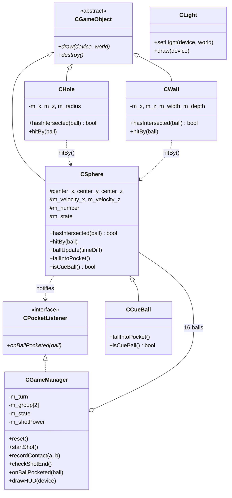

# Team 5 – 3D Pool (8-Ball) Game

A 3D 8-ball pool game written in **C++ with Direct3D 9**, developed as the team project (Project 3) of the
**Object-Oriented Programming** course (Fall 2026, Chung-Ang University).

The game is built on top of the *Virtual Billiard* sample code provided in the course.
We implemented the missing collision logic of the sample, then extended it into a two-player
8-ball pool game with pockets, numbered solid / stripe balls, turns, fouls and a shot power meter.

<!-- Add a screenshot or GIF of the game here, for example:  -->

---

## Table of Contents

1. [Features](#features)
2. [Controls](#controls)
3. [Game Rules](#game-rules)
4. [Requirements](#requirements)
5. [How to Build and Run](#how-to-build-and-run)
6. [Project Structure](#project-structure)
7. [Software Design (OOP)](#software-design-oop)
8. [Implementation Details](#implementation-details)
9. [Known Limitations](#known-limitations)
10. [Team](#team)
11. [Credits](#credits)

---

## Features

- **3D pool table** with a green cloth, cushions, a wooden frame and **6 pockets** (4 corners + 2 sides)
- **16 balls**: 1 cue ball, solids 1–7, the black 8-ball, and stripes 9–15
  (a stripe ball is drawn as a white ball with a colored band)
- **Ball physics**
  - ball–ball collisions (elastic collision between balls of equal mass, with a little energy loss)
  - ball–cushion bounces, including the cushion ends next to the pockets
  - rolling friction
  - movement is proportional to the frame time, so **the game runs at the same speed on fast and slow computers**
- **Two-player 8-ball rules**: SOLID / STRIPE groups, fouls, turn changes, win / lose
- **Shot power meter**: hold SPACE to charge (green → yellow → red), release to shoot
- **On-screen information**: current player, ball count, group of each player, game messages
- **Ball tray**: pocketed balls are lined up next to the table (solids on the left, the 8-ball in the middle, stripes on the right)
- **Two camera views**: perspective view and top view; the table can also be rotated with the mouse

---

## Controls

| Input | Action |
|---|---|
| **Right mouse drag** | Move the **blue ball** (the aiming target). The cue ball is shot toward the blue ball. |
| **Hold SPACE** | Charge the shot power (0 % → 100 % in 2 seconds) |
| **Release SPACE** | Shoot the cue ball toward the blue ball with the charged power |
| **Left mouse drag** | Rotate the table |
| **V** | Switch between perspective view and top view |
| **R** | Restart the game |
| **ENTER** | Wireframe mode on / off |
| **ESC** | Quit |

The blue ball only decides the **direction** of the shot; the **power** comes from how long SPACE is held.
The blue ball is hidden while the balls are rolling.

---

## Game Rules

We use a simplified version of 8-ball pool.

1. **Break** – Player 1 starts. The table is "open" (no groups yet).
2. **Groups** – The first ball pocketed legally decides the groups:
   if it is a solid (1–7), that player plays **SOLID** and the other player plays **STRIPE**, and vice versa.
3. **Turns** – If a player pockets one of their own balls without a foul, they **play again**.
   Otherwise the turn goes to the other player.
4. **Fouls** – After a foul the turn goes to the other player:
   - the cue ball falls into a pocket (*scratch*) – the cue ball is put back near the starting spot
   - the cue ball does not hit any ball
   - the cue ball first hits an opponent's ball
   - the cue ball first hits the 8-ball while the player still has balls of their own group
   - the player has already cleared their group, but the cue ball first hits a ball other than the 8-ball
   - (open table) the cue ball first hits the 8-ball
5. **Winning** – A player who has pocketed all 7 balls of their group must then pocket the **8-ball**.
   - Pocketing the 8-ball after clearing the group, without a foul → **that player wins**
   - Pocketing the 8-ball too early, or with a foul → **the other player wins**

During a shot the screen shows **"Processing..."**. The result of each shot (fouls, turn changes, the winner)
is shown at the bottom of the window.

---

## Requirements

| Item | Version / Note |
|---|---|
| OS | Windows 10 / 11 |
| IDE | **Visual Studio** with the *Desktop development with C++* workload (the project uses platform toolset **v145**) |
| Windows SDK | 10.0 (installed together with Visual Studio; provides `d3d9.h` / `d3d9.lib`) |
| D3DX 9 | **NuGet package `Microsoft.DXSDK.D3DX` 9.29.952.8** – downloaded automatically, nothing to install |
| Platform | **x86 (Win32)** |

The old *DirectX SDK (June 2010)* does **not** need to be installed: the D3DX headers, libraries and DLLs
come from the NuGet package.

> **Using Visual Studio 2022?** The project was saved with toolset v145.
> Right-click the project → **Retarget Projects** (or *Properties → General → Platform Toolset*) and choose **v143**.

---

## How to Build and Run

### 1. Clone the repository

```powershell
git clone https://github.com/baixuelin307-byte/Team5-pool.git
cd Team5-pool
```

### 2. Open and build in Visual Studio

1. Open **`VirtualLego.sln`**.
2. At the top of Visual Studio, select the configuration **Debug** (or **Release**) and the platform **x86**.
3. **Build → Rebuild Solution**.
   On the first build Visual Studio downloads the NuGet package into the `packages/` folder (an internet connection is needed).
   If it does not, right-click the solution → **Restore NuGet Packages**, then build again.
4. Press **F5** (or **Ctrl + F5**) to run.

The build output is written to `Debug/` or `Release/`.
The D3DX DLL is copied next to the executable automatically
(`D3dx9d_43.dll` for Debug, `D3DX9_43.dll` for Release).

### 3. Running the program on another computer

Copy the executable **together with the D3DX DLL** from the same folder:

| Build | Files to copy |
|---|---|
| Release | `VirtualLego.exe` + `D3DX9_43.dll` |
| Debug | `VirtualLego.exe` + `D3dx9d_43.dll` |

Alternatively, install the *DirectX End-User Runtime* from Microsoft on that computer.

### Troubleshooting

| Problem | Solution |
|---|---|
| `LNK1104: cannot open file 'd3dx9.lib'` | The NuGet package was not restored. Right-click the solution → *Restore NuGet Packages*, then rebuild. |
| *"This project references NuGet package(s) that are missing"* | Same as above (restore the NuGet packages). |
| *"The build tools for v145 cannot be found"* | Retarget the project to the toolset of your Visual Studio (for example v143 for VS 2022). |
| *"d3dx9_43.dll was not found"* when running the exe | Copy the D3DX DLL next to the exe (see the table above). |
| x64 build fails | Use the **x86** platform. The project is set up for 32-bit only. |

---

## Project Structure

```
Team5-pool/
├── VirtualLego.sln                 Visual Studio solution
├── VirtualLego.vcxproj             project file
├── VirtualLego.vcxproj.filters     file groups shown in Solution Explorer
├── packages.config                 NuGet package list (Microsoft.DXSDK.D3DX)
│
├── virtualLego.cpp                 main program: global objects, Setup / Display / Cleanup,
│                                   input handling (WndProc), WinMain
├── Constants.h                     table size, physics values, ball colors, helper functions
├── GameObject.h                    CGameObject (abstract base class), CPocketListener (interface)
├── Sphere.h / Sphere.cpp           CSphere (ball), CCueBall (cue ball)
├── Wall.h / Wall.cpp               CWall (cloth, cushions, frame, tray)
├── Hole.h / Hole.cpp               CHole (pocket)
├── Light.h / Light.cpp             CLight (point light, from the sample code)
├── GameManager.h / GameManager.cpp CGameManager (rules, turns, fouls, HUD text, power bar)
└── d3dUtility.h / d3dUtility.cpp   Direct3D helper functions (from the sample code, unchanged)
```

Every class has its own header (`.h`, declarations) and source file (`.cpp`, implementation).

---

## Software Design (OOP)

### Class diagram



### How the OOP concepts are used

| Concept | Where |
|---|---|
| **Encapsulation** | Each object keeps its own data private and offers methods to work with it. For example, only `CSphere` changes its own position and velocity (`setCenter`, `setPower`), and the game rules are hidden inside `CGameManager`. |
| **Inheritance** | `CSphere`, `CWall` and `CHole` inherit from the abstract class `CGameObject`. `CCueBall` inherits from `CSphere` and reuses all ball physics. |
| **Polymorphism** | All drawable objects are stored in one list, `std::vector<CGameObject*>`, and drawn with a single loop: `g_drawList[i]->draw(...)`. Each object draws itself in its own way. |
| **Virtual functions** | `CHole::hitBy()` calls `ball.fallIntoPocket()`. For a normal ball (`CSphere`) the ball goes to the tray; for the cue ball (`CCueBall`) the ball disappears and the turn becomes a foul. The pocket does not need to know which kind of ball it is. |
| **Abstract class / interface** | `CGameObject` has pure virtual functions (`draw`, `destroy`). `CPocketListener` is an interface: a ball tells the game "I was pocketed" without depending on the `CGameManager` class. |
| **Responsibility of objects** | Like the billiards case study in Chapter 7 of the textbook, every object is responsible for its own behavior: a ball moves itself, a cushion bounces a ball, a pocket captures a ball, and the game manager only judges the result. |

### Main loop

```
WinMain
 └─ Setup()                          create the table, pockets, balls, light, fonts
 └─ EnterMsgLoop(Display)            repeated every frame:
      Display(timeDelta)
       ├─ update the power meter while SPACE is held
       ├─ if a shot is in progress:
       │    ├─ split the frame into small steps (so fast balls do not pass through each other)
       │    └─ physicsStep()  ×  steps
       │         ├─ move every ball            CSphere::ballUpdate
       │         ├─ ball  – ball collisions    CSphere::hitBy
       │         ├─ ball  – pocket             CHole::hitBy  →  fallIntoPocket()
       │         └─ ball  – cushion            CWall::hitBy
       │    └─ CGameManager::checkShotEnd()     judge the shot when every ball has stopped
       ├─ draw every object in g_drawList (polymorphism)
       └─ CGameManager::drawHUD()               text and power bar
 └─ Cleanup()
```

---

## Implementation Details

### Ball – ball collision (`CSphere::hasIntersected`, `CSphere::hitBy`)

- Two balls touch when the distance between their centers is **≤ the sum of their radii**.
- On a collision:
  1. the balls are pushed apart so they no longer overlap;
  2. the velocities are split into a **normal** part (along the line between the centers) and a **tangential** part;
  3. because all balls have the same mass, the normal parts are **exchanged**
     (multiplied by a restitution factor of 0.95), and the tangential parts are kept.
- If the two balls are already moving apart, nothing is changed. This prevents balls from sticking together.

### Ball – cushion collision (`CWall::hasIntersected`, `CWall::hitBy`)

- A cushion is a box. We find the **point of the box closest to the ball center**;
  the ball touches the cushion if this point is closer than one radius.
- The direction from that point to the ball center is the surface normal.
  The ball is pushed out, and the velocity component going into the cushion is reflected
  (restitution 0.8).
- Using the closest point makes the **ends of the cushions** (the "jaws" of the pockets) behave correctly too.

### Pockets (`CHole`)

- A ball falls into a pocket when its **center** enters the pocket circle.
- The cushions have openings at the pockets, so a ball can roll into a pocket.
  As a safety check, a ball that leaves the table area is also treated as pocketed.

### Frame-rate independence

- Every movement is `velocity × timeDelta`, where `timeDelta` is the time since the last frame.
- When balls move fast, one frame is divided into several smaller physics steps,
  so a fast ball cannot jump over another ball or through a cushion.
- We tested that a ball travels the same distance in one second at 60 fps and at 240 fps.

### Shot power

- While SPACE is held, the power grows from 0 % to 100 % in 2 seconds (measured with `GetTickCount`).
- When SPACE is released, the cue ball gets the speed `MAX_POWER × power` in the direction of the blue ball.
- If the window loses focus while charging, the charge is cancelled.

### Main tuning values (`Constants.h`)

| Constant | Value | Meaning |
|---|---|---|
| `TABLE_HALF_X`, `TABLE_HALF_Z` | 4.5, 2.25 | half size of the playing area (2 : 1 like a real pool table) |
| `M_RADIUS` | 0.21 | ball radius |
| `BALL_BOUNCE` | 0.95 | ball–ball restitution |
| `WALL_BOUNCE` | 0.80 | ball–cushion restitution |
| `MAX_POWER` | 6.0 | maximum shot speed |
| `STOP_SPEED` | 0.06 | a ball slower than this stops |
| `CORNER_POCKET`, `SIDE_POCKET` | 0.32, 0.28 | pocket radii |

---

## Known Limitations

- No spin (top spin, back spin, side spin) and no "jump" shots; balls slide on the table without visual rotation.
- After a scratch the cue ball is placed automatically near the starting spot (no free "ball in hand" placement).
- The rules are simplified (for example, there is no "call the pocket" rule and no special break rules).
- Stripe balls show a colored band instead of a texture with numbers.
- Only the x86 (32-bit) build is supported.

---

## Team

**Team 5** – Object-Oriented Programming (Fall 2026), Chung-Ang University

| Name | Role |
|---|---|
| *(name)* | *(e.g. team leader, presentation)* |
| *(name)* | *(e.g. physics: CSphere, CWall, CHole)* |
| *(name)* | *(e.g. game rules and HUD: CGameManager, power meter)* |
| *(name)* | *(e.g. report, demo video)* |

---

## Credits

- **Sample code**: *Virtual Billiard* (based on *Virtual LEGO*) – original author Chang-hyeon Park,
  modified by Bong-Soo Sohn and Dong-Jun Kim, provided in the OOP course.
- **`d3dUtility.h / .cpp`**: Frank Luna, *Introduction to 3D Game Programming with DirectX 9.0* (unchanged).
- **Design idea**: the billiards case study (Chapter 7, *A Case Study: A Billiards Game*) of the course textbook.
- **D3DX 9**: Microsoft, NuGet package `Microsoft.DXSDK.D3DX`.

This repository is a course project for educational purposes. The sample code and `d3dUtility` belong to their original authors.
